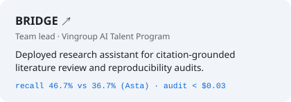
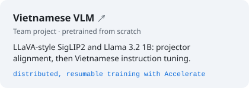
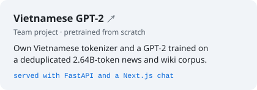
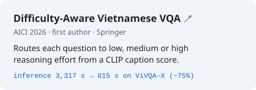
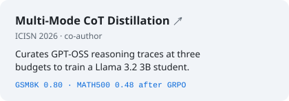

### Trần Đại Nhân

**AI Engineer**

Researcher, TA and research team lead at [AI VIET NAM](https://aivietnam.edu.vn) 
Founder and technical lead of [PawCal](https://hugebenevolence.github.io/#pawcal) 
Software Engineering, FPT University

 

 

#### Selected work

<a href="https://hugebenevolence.github.io/work/litreview/"><picture><source media="(prefers-color-scheme: dark)" srcset="assets/cards/bridge-dark.svg"></picture></a>
<a href="https://github.com/hugebenevolence/Smart-Medical-Intelligent-Ledger-for-E-health-S.M.I.L.E-"><picture><source media="(prefers-color-scheme: dark)" srcset="assets/cards/smile-dark.svg"></picture></a>
<a href="https://github.com/Datyth/ZaloAI-Challenge-lifemate"><picture><source media="(prefers-color-scheme: dark)" srcset="assets/cards/lifemate-dark.svg"></picture></a>
<a href="https://github.com/hugebenevolence/zalo-ai-challenge-datamate-26"><picture><source media="(prefers-color-scheme: dark)" srcset="assets/cards/datamate-dark.svg"></picture></a>
<a href="https://github.com/hugebenevolence/pretrain_vlm"><picture><source media="(prefers-color-scheme: dark)" srcset="assets/cards/vlm-dark.svg"></picture></a>
<a href="https://github.com/hugebenevolence/vietnamese-gpt2"><picture><source media="(prefers-color-scheme: dark)" srcset="assets/cards/gpt2-dark.svg"></picture></a>

#### Publications

<a href="https://github.com/hugebenevolence/ViVQA-GPT-OSS-DRA"><picture><source media="(prefers-color-scheme: dark)" srcset="assets/cards/vqa-dark.svg"></picture></a>
<a href="https://github.com/hugebenevolence/LLaMA-OSS"><picture><source media="(prefers-color-scheme: dark)" srcset="assets/cards/cot-dark.svg"></picture></a>

