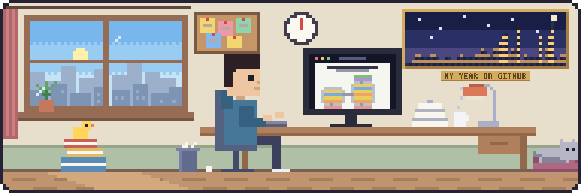

  
   
  The framed city on the wall is my last year on GitHub: one building per week, a lit window for each active day.

<h1 align="center">Trần Đại Nhân</h1>

  <picture>
    <source media="(prefers-color-scheme: dark)" srcset="assets/typing-dark.svg">
    
  </picture>

  <b>AI Engineer</b> &nbsp;·&nbsp; Research Assistant and Teaching Assistant at <a href="https://aivietnam.edu.vn">AI VIET NAM</a>

  I work where research meets engineering, turning new ideas into AI systems that hold up in practice. 
  Alongside that, I teach and help learners build a solid foundation in modern AI.

  
  
  
  
  
  

