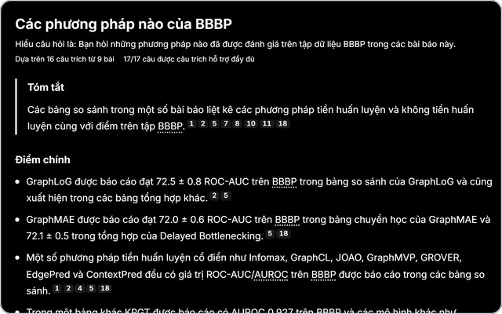
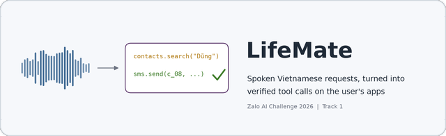
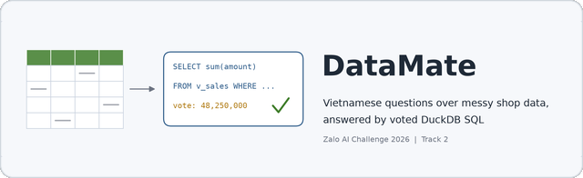
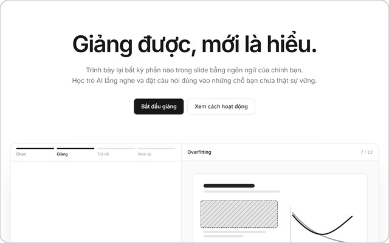
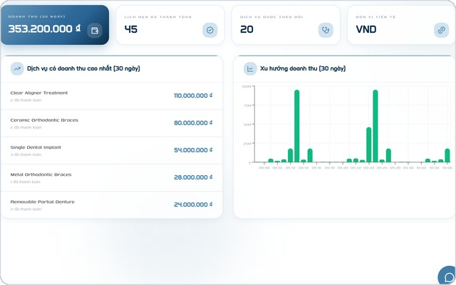

### Trần Đại Nhân

**AI Engineer**

Team lead at the Vingroup AI Talent Program 
AI researcher and teaching assistant at [AI VIET NAM](https://aivietnam.edu.vn) 
Software Engineering, FPT University

 

#### Selected work

<table>
<tr>
<td width="50%" valign="top">

 
<b><a href="https://hugebenevolence.github.io/work/litreview/">LitReview</a></b> &nbsp;Team lead · Vingroup AI Talent Program
 
A literature-review agent that checks every citation against the paper's full text.
 
<samp>2.6× the recall of Asta Paper Finder · 0 fabricated citations</samp>
</td>
<td width="50%" valign="top">

 
<b>Zalo AI Challenge 2026</b> &nbsp;Track 1 and Track 2
 
<a href="https://github.com/Datyth/ZaloAI-Challenge-lifemate">LifeMate</a> turns spoken requests into verified tool calls;
<a href="https://github.com/hugebenevolence/zalo-ai-challenge-datamate-26">DataMate</a> answers shop questions with voted SQL.
 
<samp>Track 1 public 61.26 · Track 2 public PA 0.683</samp>
</td>
</tr>
</table>

<table>
<tr>
<td width="50%" valign="top">

 
<b><a href="https://github.com/hugebenevolence/K4-3A-E403-Ke_Doc_Hanh">Kẻ Độc Hành</a></b> &nbsp;Tech lead · 2nd place, Vingroup AI hackathon
 
A voice tutor: you explain a slide, and an AI student asks back wherever the explanation is thin.
 
<samp>Built in 47.5 hours · $0.008 per session</samp>
</td>
<td width="50%" valign="top">

 
<b><a href="https://github.com/hugebenevolence/Smart-Medical-Intelligent-Ledger-for-E-health-S.M.I.L.E-">S.M.I.L.E</a></b> &nbsp;Booking, payments and identity · Capstone
 
Practice management for a multi-clinic dental network: 4 NestJS services, 5 PostgreSQL databases.
 
<samp>Race-free slot booking · idempotent VNPay payments</samp>
</td>
</tr>
</table>

#### Publications

- **Difficulty-Aware Adaptive Reasoning for Vietnamese VQA with GPT-OSS**. First author, AICI 2026 (Springer).
  Routes each question to low, medium or high reasoning effort; 75% less inference time on ViVQA-X.
  [Code](https://github.com/hugebenevolence/ViVQA-GPT-OSS-DRA)
- **Curating Multi-Mode CoT for Efficient Math Reasoning with GPT-OSS**. Co-author, ICISN 2026.
  Distils GPT-OSS reasoning into Llama 3.2 3B; GSM8K 0.80 and MATH500 0.48 after GRPO.
  [Code](https://github.com/hugebenevolence/LLaMA-OSS)

The room above is drawn in code: <a href="assets/build_room.py">assets/build_room.py</a>

