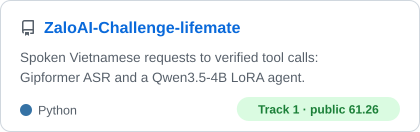
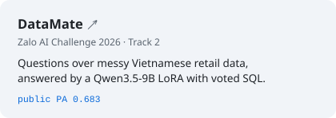
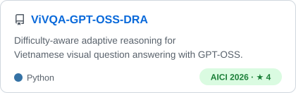
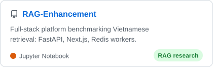

  
  
  
  

## About me

I build AI systems that hold up outside the notebook: LLM agents that call tools under strict checks, Vietnamese speech and
language pipelines, text-to-SQL over messy business data, retrieval-augmented generation and multimodal models. I am a
final-year Software Engineering student at FPT University, with a background in backend engineering.

- **Now:** AI Researcher and Teaching Assistant at **AI VIET NAM**.
- **Before:** Developer at **FPT Software HCM**; President of **FCODER Club**, ranked first among FPT University's academic
  clubs in two of three terms.
- **Focus:** LLM agents and tool calling, fine-tuning (LoRA, SFT), speech recognition, RAG, Vietnamese visual question answering.
- **Open to:** full-time roles in AI engineering, backend engineering and AI product development.

## Featured work

<table>
  <tr>
    <td width="50%">
      <a href="https://github.com/Datyth/ZaloAI-Challenge-lifemate">
        <picture>
          <source media="(prefers-color-scheme: dark)" srcset="assets/cards/lifemate-dark.svg">
          
        </picture>
      </a>
    </td>
    <td width="50%">
      <a href="https://github.com/hugebenevolence/zalo-ai-challenge-datamate-26">
        <picture>
          <source media="(prefers-color-scheme: dark)" srcset="assets/cards/datamate-dark.svg">
          
        </picture>
      </a>
    </td>
  </tr>
  <tr>
    <td width="50%">
      <a href="https://github.com/hugebenevolence/ViVQA-GPT-OSS-DRA">
        <picture>
          <source media="(prefers-color-scheme: dark)" srcset="assets/cards/vivqa-dark.svg">
          
        </picture>
      </a>
    </td>
    <td width="50%">
      <a href="https://github.com/hugebenevolence/RAG-Enhancement">
        <picture>
          <source media="(prefers-color-scheme: dark)" srcset="assets/cards/rag-dark.svg">
          
        </picture>
      </a>
    </td>
  </tr>
</table>

## Tech stack

  

  
  
  
  

## Contributions

  <picture>
    <source media="(prefers-color-scheme: dark)" srcset="https://raw.githubusercontent.com/hugebenevolence/hugebenevolence/output/github-snake-dark.svg">
    
  </picture>

## Contact

I am open to full-time roles and to research or product collaborations in AI engineering, backend engineering and
AI-driven software.

